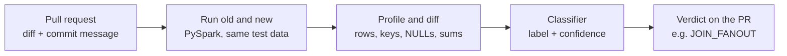

# PipeGuard – Silent Data-Bug Detection for PySpark Pipeline Changes

> **Status:** project proposal (week 5). Sections marked *Planned* describe the plan; *TBD* sections will be filled as the project progresses.
>
> Course project · LLMs and Applications · Solo project by Ben Shakarof

---

## 1. Project motivation
Data pipelines (Spark, Airflow) feed dashboards, reports and ML models, and engineers change them every week, more and more often with AI coding assistants. A **silent data bug** does not crash the job: the run succeeds, but the output numbers are wrong (duplicated revenue, dropped customers, shifted dates).

Such bugs are hard to catch:
- there is no error and no log;
- whether a change is a bug depends on the **data** (is the key unique? are there NULLs?) and on the **intent** (was the drop in rows on purpose?);
- code review usually does not see the data, data tests catch only what someone thought to check, and data-diff tools show what changed but leave a human to judge whether it is a bug.

**Users:** data engineers reviewing PySpark pull requests before merge.

## 2. Problem statement
Multi-class classification of a pipeline change (*Planned*):

- **Input:** code diff + commit message + output profiles (row counts, distinct keys, NULL rates, sums) of the old and new versions, both run on the same test data.
- **Output:** one of 8 labels with confidence – 6 silent-bug types and 2 OK types.
- **Scope:** one semantic change per example; both versions run successfully.

| Label | Code clue | Data signature |
|---|---|---|
| `JOIN_FANOUT` | join table or key changed | rows up, distinct keys unchanged |
| `JOIN_DROP` | left join became inner | rows down, unmatched keys vanish |
| `UNION_MISALIGN` | `union` instead of `unionByName` | two columns swap distributions |
| `NULL_FILTER_DROP` | `!=` or `NOT IN` filter | more rows dropped than matched; NULL% to 0 |
| `TIMEZONE_SHIFT` | date conversion or timezone setting | totals equal, daily split shifts |
| `CAST_TRUNCATION` | cast to a narrower type | values rounded, sums drop |
| `OK_REFACTOR` | code restructured | profile identical |
| `OK_INTENDED` | logic changed on purpose | change matches the explicit change request |

**Research question:** do runtime data profiles improve over code-only baselines?

## 3. Visual abstract
*Draft – a final figure will be added to `Visuals/`.*



## 4. Datasets used or collected
*Planned:*
- **D1 – Pipelines and test data:** 8 clean PySpark pipelines written by me, with synthetic input tables containing controlled traps (non-unique keys, NULLs, events near midnight).
- **D2 – Change scenarios (train + test):** ~1,500 validated scenarios (bugs, refactors, intended changes). Labels by construction, kept only if validated.
- **D3 – LLM-generated changes (test only):** ~40 change requests carried out by an LLM on the controlled pipelines; labeled by me, with a second annotator on 20 cases (Cohen's κ). A first generalization check, not a per-class benchmark.

## 5. Data augmentation and generation methods
*Planned:*
1. Assign pipelines to train / test groups **before** generating scenarios.
2. Generate scenarios within each group with an attribute grid (bug type × data trap × commit-message style).
3. Commit messages are generated by GPT-4o-mini from the change request only, with no label hints.
4. Run both versions, assert the expected behavior, and reject invalid scenarios.

## 6. Input/Output examples
*Illustrative example:*

```text
COMMIT:  "Use customer history table for richer attributes"
DIFF:    - .join(customers,      on="customer_id", how="left")
         + .join(customers_hist, on="customer_id", how="left")
PROFILE: rows 10,000 -> 23,140 | distinct order_id 10,000 -> 10,000 | sum(amount) 1.20M -> 2.77M
OUTPUT:  JOIN_FANOUT
```

## 7. Models and pipelines used
*Planned:*

| Type | Model | Role |
|---|---|---|
| Off-the-shelf | GPT-4o-mini few-shot + chain-of-thought on code + profile | Primary |
| Off-the-shelf | Rule baseline (one rule per bug type) + majority class | Baseline |
| Off-the-shelf | GPT-4o-mini on code only | Ablation |
| Fine-tuned | CodeBERT + classification head (HF Trainer) | Primary |
| Fine-tuned | Sentence embeddings + Logistic Regression | Light comparison |
| Fine-tuned | Small LLM with LoRA | Stretch |

## 8. Training process and parameters
*TBD.*

## 9. Metrics
*Planned:*
- **End-to-end:** detection F1 (bug vs. OK, primary), macro-F1 over 8 labels, false-alarm rate on intended changes, confusion matrix.
- **Per step:** validation pass rate of injected bugs, commit-message realism and absence of label hints, Cohen's κ on D3, inference cost and latency.
- **Protocol:** leave-pipelines-out split; 3 seeds (mean ± std) plus per-pipeline results; error analysis; D3 reported separately with raw counts.
- **Success criteria (targets, held-out D2 test):** code + profile beats the matched code-only model by ≥ 5 F1 points, with ≤ 10% false alarms on intended changes.

## 10. Results
*TBD.*

## 11. Repository structure
```text
PipeGuard/
├── README.md
├── requirements.txt
├── Slides/            # proposal, interim and final presentations (PPTX + PDF)
├── Code/
│   ├── pipelines/         # the 8 clean PySpark pipelines
│   ├── data_generation/   # synthetic input tables with controlled traps
│   ├── mutations/         # bug operators, refactors, intended changes, commit messages
│   ├── harness/           # run both versions, profile, diff, validate
│   ├── models/            # rule baseline, GPT prompting, embeddings + LR, CodeBERT
│   └── notebooks/         # EDA, experiments, figures
├── Data/
│   ├── D1_pipelines_test_data/
│   ├── D2_change_scenarios/
│   └── D3_llm_changes/
├── Results/           # CSV / JSON results of experiments
└── Visuals/           # result figures and the visual abstract
```

## 12. Team members
- **Ben Shakarof** – solo project.
